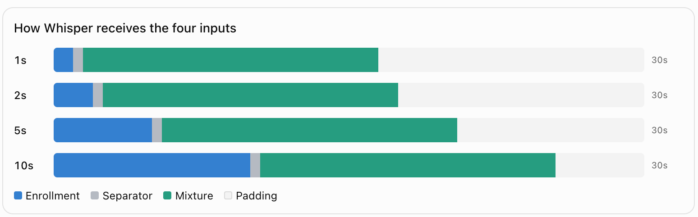
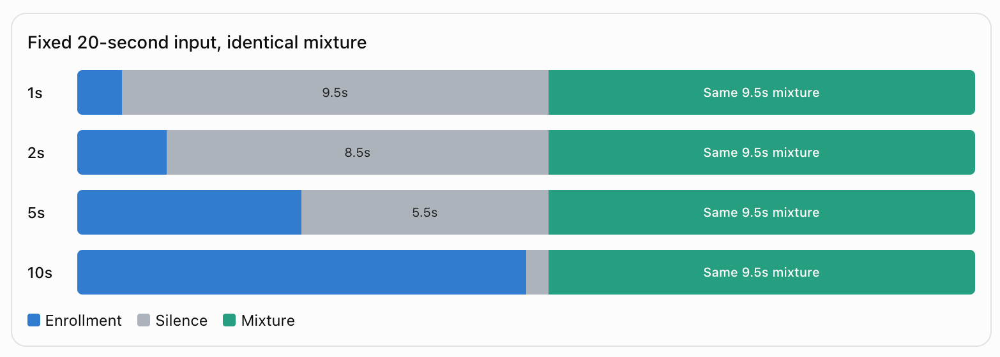

# Enrollment-layout experiments

These experiments ask how the layout of Whisper's 30 s window affects enrollment
prompting. Three models are trained on identical mixtures and tested on identical
mixtures. Only the enrollment length and the place where the mixture starts differ.

## The three setups

### 1. Randomized enrollment + fixed mixture + padding (`padding`)



`[enrollment 1-10 s | 0.5 s silence | mixture | padding to 30 s]`

The enrollment length is drawn uniformly from 1-10 s for every training example. The
separator is always 0.5 s, so the mixture starts later when the enrollment is longer.
Whisper pads the rest of the window.

### 2. Randomized enrollment + different separation + fixed mixture (`anchor`)



`[enrollment 1-10 s | silence up to 10.5 s | mixture]`

The enrollment length is drawn as in `padding`, but the mixture always starts at 10.5 s
(`--mix-start 10.5`). The silence fills the time between the end of the enrollment and
10.5 s: 9.5, 8.5, 5.5 and 0.5 s for enrollments of 1, 2, 5 and 10 s. The mixture
therefore sits on the same encoder positions for every enrollment length. A 9.5 s
mixture gives the 20 s input of the figure, and longer mixtures run to at most 30 s.

### 3. Fixed 5 s enrollment + fixed mixture (`fixed5`)

`[enrollment 5 s | 0.5 s silence | mixture | padding to 30 s]`

This is the setup of the project specification and the reference point for the other two.

## What is held fixed

- **Training mixtures.** All three runs use the same seed and the same mixture pool, capped at 19.48 s so that a 10 s enrollment plus the separator always fits. The runs therefore see identical mixtures in identical order. This holds for on-the-fly LibriSpeech 960 mixtures (default) and for Libri2Mix train-100 (`TRAIN_SOURCE=libri2mix`).
- **Training recipe.** Model, LoRA, optimizer and schedule are the same. The dev set is scored with a 5 s enrollment for checkpoint selection.
- **Test mixtures.** Libri2Mix test mixtures of at most 19.48 s are used, the subset that fits a 10 s enrollment. The enrollment for each length is cropped from the start of the same utterance. Every model is tested in the layout it was trained with.
- **Controls.** With the same mixtures and 5 s settings, the enrollment is replaced by silence, removed (`none`) or swapped for a speaker who is not in the mixture (`other`). `compare_outputs.py` measures how much the output changes. In the anchored layout, `none` keeps the mixture at 10.5 s, so only the enrollment is removed.

The cap of 19.48 s is shorter than the 24.48 s of the main experiments (`scripts/run.sh`).
`layout_fixed5` is therefore not the same model as `exp/prefix`.

## How to run

From the repository root, after `bash scripts/run.sh data` and `bash scripts/run.sh prep`:

```bash
# train (one GPU job each, they can run in parallel)
sbatch slurm/job.sbatch bash scripts/run_layout_experiments.sh train padding
sbatch slurm/job.sbatch bash scripts/run_layout_experiments.sh train anchor
sbatch slurm/job.sbatch bash scripts/run_layout_experiments.sh train fixed5

# evaluate once training has finished (lengths 1/2/5/10 s + controls)
sbatch slurm/job.sbatch bash scripts/run_layout_experiments.sh eval all

# results matrix
bash scripts/run_layout_experiments.sh table          # writes results/layout_table.md
```

Options, as environment variables:

| variable | effect |
|---|---|
| `ENROLL_CHOICES=1,2,5,10` | random layouts draw only these lengths instead of uniform 1-10 s |
| `MIX_START=10.5` | anchor position, which must be at least the longest enrollment + 0.5 s |
| `WITH_3MIX=1` | also evaluate on Libri3Mix |
| `EXTRA_TRAIN_ARGS="--max-steps 200 --eval-every 100"` | short dry run before the full jobs |
| `EXTRA_EVAL_ARGS="--batch-size 32"` | passed to every evaluation |
| `TRAIN_SOURCE=libri2mix` | train on Libri2Mix train-100 instead of LibriSpeech 960 |

A stopped training job resumes when the same command is submitted again.

## Outputs

- Checkpoints: `exp/layout_{padding,anchor,fixed5}/best`
- Per run: `results/layout_<exp>-best_libri2mix_test_clean_<mode>_enr<L>s_fit10.{summary.json,hyps.jsonl}`
- Output change: `results/layout_<exp>-best_..._<mode>_enr5s_fit10__vs__..._target_enr5s_fit10.compare.json`
- Matrix: `results/layout_table.md`, with rows = experiment, columns = 1/2/5/10 s and the controls, cells = TS-WER % (selection accuracy %)

## Reading the matrix

- **`padding` vs `anchor` at the same length.** The enrollment is identical, and only the position of the mixture and the silence differ.
- **`padding`/`anchor` vs `fixed5` at 1, 2 and 10 s.** This shows whether training on varied lengths helps lengths that `fixed5` never saw. The 5 s column shows what the random training costs at the nominal length.
- **Controls.** If the model uses the enrollment, the outputs under `silence`, `none` and `other` differ from the 5 s target output (low identical %, high output-change WER) and lose selection accuracy.

## Code

- `tsasr/data.py`: `DataConfig.mix_start` (anchored layout) and `DataConfig.enroll_choices` (discrete lengths)
- `scripts/train.py`: `--mix-start`, `--enroll-choices`, `--max-mix-sec`. The layout is stored in the checkpoint.
- `scripts/evaluate.py`: uses the stored layout, and `--mix-start` overrides it
- `scripts/run_layout_experiments.sh`, `scripts/layout_table.py`
